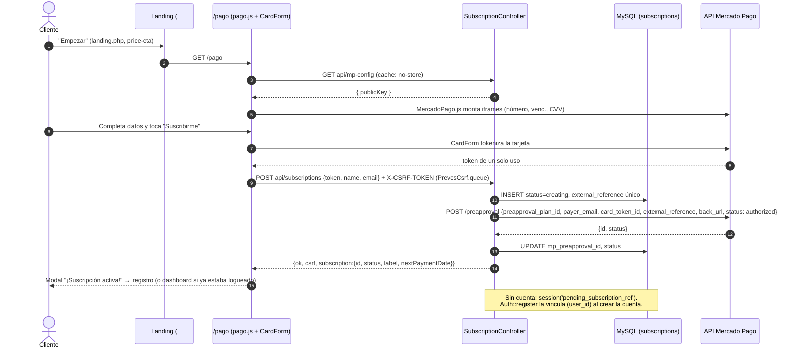

# Integración Mercado Pago · PrevCS Pro (Suscripciones)

> **Estado al 16/09/2026:** código terminado y verificado **sin credenciales**.
> Falta cargar credenciales de prueba, crear el plan y hacer la primera prueba end-to-end.
>
> Este documento sirve para dos lectores:
> - **Vos (humano):** qué se hizo, qué te falta conseguir y cómo probar.
> - **Claude (próxima sesión):** contexto completo para continuar sin volver a descubrir nada.
>   Ver la sección [Guía para Claude](#10-guía-para-claude-cómo-continuar).

---

## Índice

1. [Resumen en 30 segundos](#1-resumen-en-30-segundos)
2. [Decisiones tomadas](#2-decisiones-tomadas)
3. [Cómo funciona el flujo](#3-cómo-funciona-el-flujo)
4. [Archivos creados y modificados](#4-archivos-creados-y-modificados)
5. [API interna (rutas)](#5-api-interna-rutas)
6. [Base de datos](#6-base-de-datos)
7. [Configuración (.env) y cambio de precio](#7-configuración-env-y-cambio-de-precio)
8. [Qué ya está verificado](#8-qué-ya-está-verificado)
9. [Lo que te falta conseguir](#9-lo-que-te-falta-conseguir)
10. [Guía para Claude: cómo continuar](#10-guía-para-claude-cómo-continuar)
11. [Plan de testeo](#11-plan-de-testeo)
12. [Riesgos y puntos sin verificar](#12-riesgos-y-puntos-sin-verificar)
13. [Checklist para pasar a producción](#13-checklist-para-pasar-a-producción)
14. [Referencias](#14-referencias)

---

## 1. Resumen en 30 segundos

- **Producto elegido:** Mercado Pago **Suscripciones con plan** (`preapproval_plan` + `preapproval`), Argentina, **ARS**.
- **Por qué:** PrevCS Pro es un plan único **mensual** ("cancelás cuando quieras"). Un pago único (Checkout Pro o Bricks) obligaría a cobrar a mano cada mes.
- **Stack:** PHP 8.2 + CodeIgniter 4.7 (XAMPP, MySQL) + SDK oficial `mercadopago/dx-php` **3.16.0** (Composer) + MercadoPago.js v2 (CardForm) en el navegador.
- **Qué ve el cliente:** en `/pago` completa nombre y email, elige Mercado Pago, carga la tarjeta en **campos seguros** (iframes de Mercado Pago) y toca **Suscribirme**. La suscripción queda `authorized` y sigue al registro (o al dashboard si ya estaba logueado).
- **Precio:** vive en el `.env` (`MP_PLAN_AMOUNT=1000`, `MP_PLAN_CURRENCY=ARS`). Lo leen el cobro, `/pago` y la landing. Para cambiarlo: editar el `.env` y correr `php spark mp:plan`.
- **PayPal:** **se dejó exactamente como estaba (simulado)**, por pedido explícito del usuario. Se integrará otro día.

---

## 2. Decisiones tomadas

| Tema | Decisión | Motivo |
|---|---|---|
| Producto | Suscripciones **con plan** | Lo eligió el usuario. El precio vive en un plan reutilizable de Mercado Pago. |
| País / moneda | AR / ARS | Mercado Pago no cobra en USD. El "USD 49" escrito a mano se reemplazó por el precio del `.env`. |
| Precio de ejemplo | ARS 1.000 / mes | Pedido del usuario. |
| Cobro de la tarjeta | MercadoPago.js **CardForm** (`iframe: true`) en `/pago` | El modelo "con plan" exige tokenizar la tarjeta en tu sitio. La tarjeta nunca toca nuestro servidor: llega solo un token de un uso. |
| Backend | SDK oficial `mercadopago/dx-php` 3.16.0 | Recomendación del plugin y autorizado por el usuario. Trae `PreApprovalClient` y `PreApprovalPlanClient`. |
| Creación del plan | **Solo por consola** (`php spark mp:plan`) | Crear o cambiar planes es tarea de operador, nunca una ruta web pública. |
| Dónde vive la oferta | `app/Config/Subscription.php` ← `.env` | El navegador **nunca** manda monto, moneda, frecuencia ni ID de plan. |
| Pago antes del registro | Se permite (`/pago` es público) | Así era el flujo existente: Pago → Registro → Checkout → Dashboard. La suscripción se vincula a la cuenta al registrarse. |
| PayPal | **No tocar** | Pedido del usuario: "dejá como está, otro día agrego esa integración". |
| Credenciales | Primero **Prueba**; producción = cambiar el `.env` | Pedido del usuario: "testear todo el flujo y que quede sencillo para cambiarlo a producción". |
| Validador oficial del plugin (Node) | Se salteó | Node.js no está instalado. Además está pensado para JS (ver [§12](#12-riesgos-y-puntos-sin-verificar)). |
| Creación de la app en Mercado Pago | **Manual** (la hace el usuario) | El conector MCP de Mercado Pago no estaba autorizado en la sesión. |

---

## 3. Cómo funciona el flujo



**Estados de la suscripción:**
- **Locales:** `creating` (antes de llamar a Mercado Pago) y `failed` (Mercado Pago rechazó o no respondió).
- **De Mercado Pago:** `pending`, `authorized`, `paused` y `cancelled`.

La UI muestra estos estados:

| Estado | Qué ve el cliente |
|---|---|
| Inicializando | "Inicializando el pago seguro…" |
| Procesando | Botón bloqueado, texto "Procesando…" |
| `authorized` | Modal "¡Suscripción activa!" |
| `pending` | Modal "Suscripción pendiente" |
| `paused` | Aviso "Suscripción pausada" |
| `cancelled` | Error "Suscripción cancelada" |
| Error | Mensaje claro de qué hacer, nunca el error crudo de la API |

---

## 4. Archivos creados y modificados

### Estado en Git (16/09/2026)

- **Ya commiteado** por el usuario en `913bb07` y `5f9ff2f` (15/09): todo lo marcado ✅.
- **Sin commitear todavía:** lo marcado 🟡. **Sin estos archivos lo commiteado no funciona** (faltan el controlador y el comando).

| Estado Git | Archivo | Qué hace |
|---|---|---|
| ✅ | `composer.json` / `composer.lock` | Agrega `"mercadopago/dx-php": "^3.16"` (instalado 3.16.0). |
| ✅ | `.gitignore` | Agrega `vendor/`, `.env.*.local` y `.mp-integrate-progress.md`. |
| ✅ | `.env.example` | Plantilla de variables de Mercado Pago, con instrucciones para pasar a producción. |
| ✅ | `app/Config/Subscription.php` | **Oferta confiable:** lee el `.env` y expone `trustedOffer()`, `backUrl()`, `isConfigured()`, `displayPrice()` y `displayAmount()`. |
| ✅ | `app/Database/Migrations/2026-09-15-000001_CreateSubscriptionsTable.php` | Tabla `subscriptions` (ya migrada el 16/09). |
| ✅ | `app/Models/SubscriptionModel.php` | `start()`, `findByReference()`, `activeForUser()` y `linkToUser()`. |
| ✅ | `app/Libraries/MercadoPagoSubscriptions.php` | Único punto de contacto con el SDK: `subscribe`, `find`, `changeStatus`, `createPlan`, `findPlan` y `updatePlan`. |
| ✅ | `app/Config/Routes.php` | 4 rutas nuevas (ver [§5](#5-api-interna-rutas)). |
| ✅ | `app/Config/Filters.php` | `api/mp-config` y `api/subscriptions` quedan fuera de `authGuard`; el resto de `api/subscriptions/*` sigue protegido. |
| ✅ | `app/Controllers/Auth.php` | En `register()`, vincula `pending_subscription_ref` con el usuario nuevo. |
| ✅ | `app/Controllers/Pago.php` | Pasa `planPrice` y `planAmount` a la vista. |
| ✅ | `public/css/pago.css` | Estilos de `.pay-card`, `.pay-secure-input` (hosts de iframes) y `.pay-status`. |
| 🟡 | `app/Controllers/SubscriptionController.php` | **Nuevo.** `config`, `create`, `show` y `lifecycle`. Respuestas `{ok, csrf, …}`. |
| 🟡 | `app/Commands/MercadoPagoPlan.php` | **Nuevo.** `php spark mp:plan`: crea o actualiza el plan (pide confirmación). |
| 🟡 | `app/Views/pago.php` | Bloque "03 · Datos de la tarjeta", `payStatus`, botón con `data-mp-subscription-cta`, SDK `sdk.mercadopago.com/js/v2`. Precio desde la config. PayPal intacto. |
| 🟡 | `public/js/pago.js` | CardForm, carga de la Public Key, `subscribe()` con `PrevcsCsrf.queue`, estados y modal. La simulación de PayPal se conserva. `scheduleMount()` evita doble petición. |
| 🟡 | `app/Controllers/Landing.php` | Pasa `planCurrency`, `planAmount` y `planAmountLabel`. |
| 🟡 | `app/Views/landing.php` | La tarjeta de precio usa la moneda y el monto del `.env` (antes "USD 49" fijo). |
| (local) | `vendor/` | Ignorado en Git. En cada PC: `composer install --no-dev`. |
| (local) | Base `prevcs` | Tabla `subscriptions` creada con `php spark migrate` el 16/09. |

Memoria de Claude actualizada: `prevcs-mercadopago.md` y `prevcs-ajax-csrf.md` (nota sobre `vendor/`).

---

## 5. API interna (rutas)

| Método y ruta | Controlador | Acceso | Descripción |
|---|---|---|---|
| `GET api/mp-config` | `SubscriptionController::config` | público | `{ publicKey }` con `Cache-Control: no-store, max-age=0`. Devuelve 503 con `{error}` si falta `MP_PUBLIC_KEY`. |
| `POST api/subscriptions` | `::create` | público + CSRF | Body JSON `{ token, name, email }`. Devuelve `{ok, csrf, subscription}` o `{ok:false, error, csrf}`. |
| `GET api/subscriptions/{external_reference}` | `::show` | logueado y **dueño** | Consulta `GET /preapproval/{id}` en Mercado Pago y sincroniza el estado local. |
| `POST api/subscriptions/{external_reference}/(pause\|reactivate\|cancel)` | `::lifecycle` | logueado, **dueño** y CSRF | Mapea la acción al estado `paused`, `authorized` o `cancelled` (lista cerrada). `cancelled` es final. |

**Códigos de error de `create`:**

| Código | Cuándo |
|---|---|
| 422 | Datos inválidos, o Mercado Pago rechazó (400/422) |
| 409 | La cuenta logueada ya tiene una suscripción `pending`, `authorized` o `paused` |
| 503 | Faltan credenciales o `MP_SUBSCRIPTION_PLAN_ID` |
| 502 | Mercado Pago dio 5xx o no hubo conexión |
| 500 | No se pudo insertar la fila |

`spark routes` muestra `<unknown>` en los filtros de la ruta de ciclo de vida. Es solo una limitación de visualización por el patrón regex: la ruta no está en las excepciones de `authGuard`, así que queda protegida.

---

## 6. Base de datos

Tabla `subscriptions`:

| Columna | Tipo | Notas |
|---|---|---|
| `id` | INT PK | |
| `user_id` | INT NULL | Vacío si pagó antes de registrarse. |
| `external_reference` | VARCHAR(64) **UNIQUE** | `prevcs-sub-<24 hex>`. Ancla de reconciliación y es el `id` público de la API. |
| `mp_preapproval_id` | VARCHAR(64) NULL, índice | ID de la suscripción en Mercado Pago. |
| `mp_plan_id` | VARCHAR(64) | Plan usado. |
| `payer_email` / `payer_name` | VARCHAR | |
| `status` | VARCHAR(20), default `creating` | `creating`, `failed`, `pending`, `authorized`, `paused` o `cancelled`. |
| `amount` / `currency` | DECIMAL(12,2) / CHAR(3) | Foto del precio al suscribirse. |
| `created_at` / `updated_at` | DATETIME | Timestamps del modelo. |

Consulta útil para las pruebas:

```sql
SELECT id, user_id, external_reference, mp_preapproval_id, status, amount, currency, created_at, updated_at
FROM subscriptions ORDER BY id DESC LIMIT 10;
```

Para deshacer (solo en local y **preguntando antes**): `php spark migrate:rollback`.

---

## 7. Configuración (.env) y cambio de precio

Copiar a `.env` el bloque de `.env.example`:

```ini
MP_ACCESS_TOKEN=            # Servidor · SECRETO · pestaña "Prueba" para testear
MP_PUBLIC_KEY=              # Navegador · público · misma pestaña
MP_SUBSCRIPTION_PLAN_ID=    # Lo imprime `php spark mp:plan` la primera vez
MP_PLAN_AMOUNT=1000
MP_PLAN_CURRENCY=ARS
MP_WEBHOOK_SECRET=          # Para cuando se agreguen webhooks
APP_URL=http://localhost/PreventiveControlSystem/public
```

- Las credenciales pueden empezar con `APP_USR-` o con `TEST-`: **las dos son válidas**. Lo que importa es **de qué pestaña** salen (Prueba o Producción).
- **Nunca** pegar las credenciales en el chat ni commitearlas (`.env` está en `.gitignore`).

### Cambiar el precio (ejemplo: 1000 → 1500)

1. En `.env`: `MP_PLAN_AMOUNT=1500`.
2. `php spark mp:plan`: muestra el plan actual contra el `.env`, pregunta y hace `PUT /preapproval_plan/{id}`.
3. La landing y `/pago` toman el nuevo valor solos.

⚠️ **Sin verificar:** si cambiar el monto del plan también cambia lo que pagan los suscriptores que ya existen. Confirmarlo en la documentación oficial o con el MCP antes de hacerlo en producción.

---

## 8. Qué ya está verificado

| Verificación | Resultado |
|---|---|
| `php -l` de los 13 archivos PHP tocados | ✅ sin errores |
| `php spark routes` | ✅ las 4 rutas están registradas; `pago` y `api/subscriptions` quedan sin `authGuard` |
| `php spark list` | ✅ aparece `mp:plan` |
| `composer show mercadopago/dx-php` | ✅ 3.16.0, sin avisos de seguridad |
| CodeIgniter arranca con `vendor/` | ✅ |
| `php spark migrate` | ✅ tabla `subscriptions` creada con las columnas esperadas |
| `GET /pago` y `GET /` | ✅ 200; precio "ARS $1.000"; sin "USD" escrito a mano en `app/` |
| `GET api/mp-config` sin credenciales | ✅ 503 con mensaje claro |
| `/pago` en el navegador sin credenciales | ✅ SDK cargado, hosts de 50 px de alto, aviso "Falta MP_PUBLIC_KEY…", **1 sola** petición de configuración (corregido hoy) |
| PayPal (regresión) | ✅ oculta la tarjeta, muestra "Pago simulado…", abre el modal "¡Pago confirmado!" y hace **0** llamadas a `api/subscriptions` |
| Búsqueda de antipatrones (`sandbox_init_point`, `%MP_PUBLIC_KEY%`, `/v1/preapproval`) | ✅ no aparecen |

**Todavía NO probado** (necesita credenciales): crear el plan, tokenizar, crear la suscripción, consultarla, pausarla, cancelarla y el vínculo al registrarse.

---

## 9. Lo que te falta conseguir

### A. Imprescindible para la primera prueba

- [ ] **Cuenta de Mercado Pago Argentina** con acceso al Developer Dashboard.
- [ ] **Crear la aplicación:** https://www.mercadopago.com.ar/developers/panel/app → *Crear aplicación* (nombre sugerido "PrevCS", tipo de pago **Suscripciones**).
- [ ] **Credenciales de Prueba** (Public Key y Access Token): app → *Credenciales* → pestaña **Prueba** → pegarlas en `.env`.
- [ ] **Plan de prueba:** `php spark mp:plan` → `s` → pegar `MP_SUBSCRIPTION_PLAN_ID=…` en `.env`.
- [ ] **Commitear los 6 archivos 🟡** (o pedírselo a Claude) para que el repo quede consistente.

### B. Muy probablemente necesario (se confirma en la primera prueba)

- [ ] **Cuentas de prueba (vendedor y comprador).** En Suscripciones es común que Mercado Pago exija que `payer_email` sea de un **comprador de prueba**, distinto del vendedor dueño de las credenciales. Se crean desde el Dashboard (*Cuentas de prueba*) o con `/mp-integrate test-setup` si el MCP está autorizado.
- [ ] **URL pública HTTPS** (por ejemplo ngrok o un hosting de prueba), por si la API rechaza `back_url` con `http://localhost`. Pasa a ser obligatoria para webhooks.

### C. Para completar la integración (antes de producción)

- [ ] **Clave secreta de Webhooks** (Dashboard → Webhooks) → `MP_WEBHOOK_SECRET`.
- [ ] **URL pública HTTPS** donde Mercado Pago pueda mandar los webhooks (localhost no sirve).
- [ ] **Decidir qué pasa con una cuenta sin suscripción activa** (hoy PrevCS **no** restringe nada según el estado de la suscripción).
- [ ] **Decidir si querés una pantalla** para que el cliente vea, pause o cancele su suscripción (la API existe, falta la UI).
- [ ] **Precio definitivo** en ARS.

### D. Para producción

- [ ] **Credenciales de Producción** (pestaña **Producción**) y la cuenta de Mercado Pago real con los datos del negocio completos.
- [ ] **Dominio con HTTPS** (`APP_URL` público).
- [ ] **Plan creado en la cuenta real** (el plan de prueba no existe ahí).
- [ ] **`/mp-review` aprobado** (checklist de calidad de Mercado Pago) y la homologación que pida Mercado Pago.

### E. Opcional pero recomendado

- [ ] **Autorizar el conector MCP de Mercado Pago** con `/mcp` en una terminal interactiva de `claude`, para que Claude pueda crear apps, traer credenciales, crear usuarios de prueba, configurar webhooks y buscar documentación actualizada.
- [ ] **Node.js LTS 20 o superior** (https://nodejs.org), solo para los scripts del plugin.
- [ ] **En cada PC nueva:** doble clic en `setup.cmd` (ver [INSTALACION.md](INSTALACION.md)). Composer necesita `git` o la extensión `zip` de PHP.

---

## 10. Guía para Claude: cómo continuar

### 10.1 Contexto que tenés que cargar primero

1. **Este documento completo.**
2. **Memorias del proyecto:** `prevcs-mercadopago.md` y `prevcs-ajax-csrf.md` (patrón CSRF).
3. **Código fuente de la integración:** `app/Config/Subscription.php`, `app/Libraries/MercadoPagoSubscriptions.php`, `app/Controllers/SubscriptionController.php`, `app/Commands/MercadoPagoPlan.php` y `public/js/pago.js`.
4. **`git status`:** confirmar si los 6 archivos 🟡 ya se commitearon.
5. **`.env` sin imprimir valores:** solo saber si cada `MP_*` está vacío o cargado. Ejemplo en PowerShell:
   ```powershell
   Select-String -Path .env -Pattern '^\s*MP_[A-Z_]+\s*=' | ForEach-Object { if ($_.Line -match '^\s*([A-Z_]+)\s*=\s*(.*)$') { "$($Matches[1]): " + ($(if ($Matches[2].Trim() -eq '') {'vacío'} else {'cargado'})) } }
   ```

### 10.2 Reglas que no se negocian

- **Idioma:** castellano rioplatense con el usuario.
- **PayPal no se toca:** ni la opción ni su simulación, hasta que el usuario lo pida.
- **No commitear, pushear ni correr rollbacks o migraciones destructivas sin pedido explícito.**
- **Credenciales:** nunca pedirlas en el chat y nunca imprimir valores del `.env`. Tampoco hardcodear claves.
- **Oferta confiable:** monto, moneda, frecuencia y ID de plan **siempre del servidor** (`Config\Subscription::trustedOffer()`), nunca del request.
- **Planes:** solo por `php spark mp:plan`. Nunca exponer una ruta web que cree o modifique planes.
- **Rutas de Mercado Pago:** exactamente `/preapproval` y `/preapproval_plan`, **sin `/v1`**. No existe sandbox: nunca usar `sandbox_init_point`.
- **Token de tarjeta:** de un solo uso. No guardarlo ni loguearlo.
- **CSRF** (`$regenerate = true`, cookie httponly):
  - las mutaciones por fetch van en `window.PrevcsCsrf.queue(...)` con header `X-CSRF-TOKEN`;
  - el servidor devuelve `csrf_hash()` en el JSON y el cliente lo guarda con `PrevcsCsrf.set`.
- **CardForm** (formulario seguro de tarjeta):
  - los 3 `<select>` ocultos (`issuer`, `installments`, `identificationType`) son obligatorios: nunca borrarlos ni ponerles `disabled`;
  - montar solo con el bloque visible;
  - `requestAnimationFrame` necesita un `setTimeout` de respaldo (no corre con la pestaña en segundo plano).
- **Errores al cliente:** mensajes accionables en castellano, nunca el error crudo de Mercado Pago.
- **MCP de Mercado Pago:** requiere autorización. Si no está, avisar al usuario y seguir con la documentación del plugin; no pedir códigos ni tokens.
- **XAMPP:** no tiene GD, Imagick ni Node.js.

### 10.3 Próximas tareas, en orden

#### Tarea 1 — Primera prueba con credenciales de Prueba (bloqueada hasta que el usuario cargue el `.env`)
1. Verificar que las `MP_*` estén cargadas (sin mostrar valores).
2. Pedirle al usuario que corra `php spark mp:plan` (es interactivo y crea un recurso en su cuenta), o correrlo solo si lo autoriza.
3. Seguir el [Plan de testeo](#11-plan-de-testeo), fases 2 a 5.
4. Si falla, leer `writable/logs/log-YYYY-MM-DD.log`. El controlador loguea operación, código HTTP, referencia y el `message` de Mercado Pago, sin token.

#### Tarea 2 — Webhooks (necesita URL HTTPS pública y `MP_WEBHOOK_SECRET`)
- **Arranque:** usar el flujo del plugin con `/mp-integrate webhook`. La validación HMAC de `x-signature` está en el skill `mp-webhooks`.
- **SDK:** antes de escribir la validación a mano, revisar si `dx-php` 3.16 ya trae un validador de firma. En `vendor/mercadopago/dx-php/src/MercadoPago/` existen `Exceptions/InvalidWebhookSignatureException.php` y `SignatureFailureReason.php`.
- **Diseño sugerido:**
  - **Ruta:** `POST api/webhooks/mercadopago` → `WebhookController::receive`.
  - **Filtros:** agregar la ruta a las excepciones de **`authGuard` y de `csrf`** en `app/Config/Filters.php` (como `api/iot/lectura`).
  - **Orden:** validar la firma → responder 200 rápido → procesar.
  - **Tópicos:**
    - `subscription_preapproval`: `GET /preapproval/{id}` y actualizar la fila por `mp_preapproval_id` o `external_reference`;
    - `subscription_authorized_payment`: cobros mensuales (evaluar una tabla `subscription_payments`);
    - `subscription_preapproval_plan`: cambios del plan;
    - `payments`: pagos subyacentes.
  - **Idempotencia:** el mismo evento puede llegar más de una vez.
- **Registro:** el webhook se configura en el Dashboard o con la herramienta `save_webhook` del MCP.

#### Tarea 3 — Mejoras de producto (preguntar antes al usuario)
- **Pantalla de suscripción** para el usuario logueado (estado, próximo cobro, pausar, reactivar, cancelar), usando las rutas `show` y `lifecycle`. Encaja en `admin-account`.
- **Restricción por suscripción:** qué pasa si la cuenta no tiene suscripción `authorized`. Hoy no se restringe nada.
- **Vínculo robusto:** hoy la vinculación depende de la sesión del mismo navegador. Evaluar vincular también por email verificado.
- **Detalle visual:** `public/js/pricing.js` anima el precio con `Math.round()` y termina mostrando "1000" en vez de "1.000". Formatear con `toLocaleString('es-AR')`.

#### Tarea 4 — Revisión y salida a producción
- `/mp-review` (checklist de calidad) y luego el [Checklist para pasar a producción](#13-checklist-para-pasar-a-producción).

### 10.4 Comandos de referencia

```bash
setup.cmd                          # PC nueva o después de un pull: vendor, .env, base y migraciones
php spark prevcs:setup             # lo mismo sin composer install
php spark mp:plan                  # crea/actualiza el plan con los valores del .env
php spark routes                   # ver rutas y filtros
php -l app/Controllers/SubscriptionController.php
```

---

## 11. Plan de testeo

**Datos de prueba para Argentina** (tomados de la documentación del plugin de Mercado Pago):

| Dato | Valor |
|---|---|
| Vencimiento | `11/30` |
| CVV | `123` (Amex `1234`) |
| DNI | `12345678` |
| Visa crédito | `4509 9535 6623 3704` |
| Mastercard crédito | `5031 7557 3453 0604` |
| Amex | `3711 803032 57522` |
| Visa débito | `4002 7686 9439 5619` |
| Mastercard débito | `5287 3383 1025 3304` |

**El nombre del titular fuerza el resultado:**

| Nombre | Resultado |
|---|---|
| `APRO` | aprobado |
| `FUND` | fondos insuficientes |
| `OTHE` | error general |
| `CONT` | pendiente |
| `SECU` | CVV inválido |
| `EXPI` | vencida |
| `CALL` | requiere autorización |

> Una suscripción `authorized` puede generar cobros. **Siempre cancelar al terminar cada prueba** (fase 4). Nunca automatizar la creación de suscripciones reales.

### Fase 0 — Sin credenciales (✅ hecha el 16/09)
Ver [§8](#8-qué-ya-está-verificado). Repetirla después de cambios grandes.

### Fase 1 — Configuración
| # | Paso | Esperado |
|---|---|---|
| 1.1 | Cargar `MP_ACCESS_TOKEN` y `MP_PUBLIC_KEY` (Prueba) y abrir `api/mp-config` | 200 `{ "publicKey": "…" }` con `Cache-Control: no-store` |
| 1.2 | `php spark mp:plan` sin `MP_SUBSCRIPTION_PLAN_ID` | Muestra la tabla del `.env`; al confirmar imprime `MP_SUBSCRIPTION_PLAN_ID=…` |
| 1.3 | Pegar el ID y correr `php spark mp:plan` de nuevo | "El plan ya coincide con el .env" |
| 1.4 | Cambiar `MP_PLAN_AMOUNT` a 1500 y correr `mp:plan` | Muestra la diferencia, pide confirmación y actualiza. Volver a 1000 y repetir. |
| 1.5 | Si 1.2 falla por `back_url` | Poner en `APP_URL` una URL HTTPS pública (ngrok) y reintentar. Anotar el resultado en este documento. |

### Fase 2 — `/pago` con credenciales (sin cobrar)
| # | Paso | Esperado |
|---|---|---|
| 2.1 | Abrir `/pago` | Aviso "Inicializando…" que desaparece; 3 iframes montados (1 por host); nada en rojo en la consola |
| 2.2 | Escribir en número, vencimiento y CVV | Los iframes aceptan foco y texto |
| 2.3 | Cambiar a PayPal y volver a Mercado Pago | El bloque de tarjeta se oculta y reaparece sin montarse dos veces (sigue 1 iframe por host) |
| 2.4 | "Suscribirme" con la tarjeta vacía | "Revisá los datos de la tarjeta…"; **0** POST a `api/subscriptions` |
| 2.5 | Email inválido | Validación nativa del email; sin POST |
| 2.6 | Con tarjeta cargada: elegir PayPal y confirmar | Sigue la simulación de siempre; **0** POST a `api/subscriptions`; sin errores de CardForm que rompan la página |

### Fase 3 — Crear suscripciones (sin sesión iniciada)
| # | Paso | Esperado |
|---|---|---|
| 3.1 | Visa `APRO`, DNI `12345678`, email del **comprador de prueba** | Modal "¡Suscripción activa!"; fila con `status=authorized`, `mp_preapproval_id` cargado y `user_id` NULL |
| 3.2 | Si 3.1 da 422 por `payer_email` | Crear el comprador de prueba (`/mp-integrate test-setup` o el Dashboard), usar su email y anotar el resultado |
| 3.3 | Nombre `FUND` | Error accionable; fila `failed`; el botón vuelve a habilitarse |
| 3.4 | Nombre `OTHE` | Igual que 3.3 |
| 3.5 | Nombre `CONT` | Modal "Suscripción pendiente" o el estado que devuelva Mercado Pago. Anotar cuál. |
| 3.6 | Doble clic rápido en "Suscribirme" | **1 solo** POST (botón deshabilitado mientras procesa) |
| 3.7 | Borrar temporalmente `MP_SUBSCRIPTION_PLAN_ID` | 503 "Las suscripciones todavía no están configuradas…"; se registra en el log |
| 3.8 | Access Token inválido (temporalmente) | Mensaje "problema con la configuración de pagos"; log con código 401/403 |

### Fase 4 — Registro, dueño y ciclo de vida
| # | Paso | Esperado |
|---|---|---|
| 4.1 | Después de 3.1, "Continuar" → registrarse con una cuenta nueva en el **mismo navegador** | La fila queda con `user_id` de la cuenta nueva |
| 4.2 | Logueado: abrir `api/subscriptions/{external_reference}` | 200 con `status`, `label` y `nextPaymentDate` |
| 4.3 | Con otra cuenta logueada, la misma URL | 404 (no es dueño) |
| 4.4 | Sin sesión, la misma URL | Redirige a `reg-log` (authGuard) |
| 4.5 | Pausar (consola del navegador, ver abajo) | `status=paused` en la respuesta, en la BD y en Mercado Pago |
| 4.6 | Reactivar | `authorized` |
| 4.7 | Cancelar | `cancelled`; volver a cancelar da 409 |
| 4.8 | Acción inventada (`api/subscriptions/{ref}/delete`) | 404 de ruta (no existe) |
| 4.9 | Logueado con suscripción activa: suscribirse otra vez desde `/pago` | 409 "Tu cuenta ya tiene una suscripción…" |

Snippet para la consola del navegador, estando en `/pago` y logueado (respeta la cola CSRF):

```js
const ref = 'prevcs-sub-XXXXXXXXXXXXXXXXXXXXXXXX'; // external_reference
const action = 'pause'; // pause | reactivate | cancel
PrevcsCsrf.queue(() => fetch(`api/subscriptions/${ref}/${action}`, {
  method: 'POST',
  headers: { Accept: 'application/json', 'X-Requested-With': 'XMLHttpRequest', 'X-CSRF-TOKEN': PrevcsCsrf.get() },
}).then(r => r.json()).then(d => { PrevcsCsrf.set(d.csrf); console.log(d); }));
```

### Fase 5 — Regresión y visual
| # | Paso | Esperado |
|---|---|---|
| 5.1 | PayPal completo (sin sesión) | Igual que antes de la integración |
| 5.2 | Landing `#precio` | Moneda y monto del `.env`; el botón lleva a `/pago` |
| 5.3 | `/pago` a 375 px de ancho | Vencimiento y CVV en una columna; nada se desborda |
| 5.4 | Modo oscuro | Hosts de iframe, avisos y bordes legibles |
| 5.5 | Otras vistas con POST por AJAX (kanban, stock) | Siguen funcionando (no se tocó el CSRF compartido) |

### Fase 6 — Webhooks (cuando existan)
- **Evento de prueba** desde el Dashboard → 200 con firma válida y 401/400 con firma inválida.
- **Cancelar la suscripción desde Mercado Pago** (no desde la app) → la fila local pasa a `cancelled` por webhook.
- **Mismo evento repetido** → sin efectos duplicados.
- **Historial de entregas:** `notifications_history` (MCP) o el Dashboard.

### Fase 7 — Calidad
- `/mp-review` sin bloqueantes.
- **Validador del plugin (opcional, con Node instalado):** ver la limitación en [§12](#12-riesgos-y-puntos-sin-verificar).

**Criterio de "listo para producción":** fases 1 a 6 aprobadas, webhooks funcionando, `/mp-review` aprobado y cada suscripción de prueba cancelada.

---

## 12. Riesgos y puntos sin verificar

| Tema | Estado | Qué hacer |
|---|---|---|
| Cambiar el monto del plan: ¿afecta a los suscriptores existentes? | **Sin verificar** | Confirmar en la documentación oficial o con MCP `search_documentation` antes de cambiar precios en producción. |
| `back_url` con `http://localhost` en el plan | **Sin verificar**; en producción debe ser HTTPS | Si la API lo rechaza, usar ngrok (fase 1.5). |
| `payer_email` tiene que ser de un comprador de prueba | **Probable**, sin verificar | Fase 3.2. |
| CardForm en Argentina pide DNI | Se agregó un campo DNI visible por las dudas | Confirmar en la fase 3.1; si no hace falta, se puede simplificar. |
| Mismo `<form>` para CardForm y PayPal | Probado solo **sin** CardForm montado | Fase 2.6. |
| Estados locales desactualizados | Sin webhooks, la BD se entera de cambios solo al llamar `show` | Tarea 2 (webhooks). |
| Acceso a PrevCS sin suscripción | La app **no** restringe nada hoy | Decisión de producto (tarea 3). |
| Vínculo pago → cuenta | Depende de la sesión del mismo navegador | Tarea 3. |
| Doble envío | Botón bloqueado y `external_reference` único por intento; la API de Suscripciones no documenta `X-Idempotency-Key` | Aceptable. Revisar en `/mp-review`. |
| Validador del plugin (`validate-subscriptions-integration.mjs`) | Busca sintaxis JS (`payer_email:`, `mpFetch(`, `app.get(`): con arrays PHP (`=>`) y el SDK marcaría **falsos negativos** | No "arreglar" el PHP para complacer al regex. Usar el checklist manual y `/mp-review`. |
| El precio animado de la landing muestra "1000" | Detalle visual | Tarea 3. |
| Composer sin la extensión `zip` | Funciona clonando con git | Habilitar `extension=zip` en `php.ini` si molesta. |
| Pasar a producción | Hay que crear el plan **de nuevo** en la cuenta real | [§13](#13-checklist-para-pasar-a-producción). |

---

## 13. Checklist para pasar a producción

- [ ] Webhooks implementados, con firma validada y probados (fase 6).
- [ ] `/mp-review` aprobado y homologación de Mercado Pago completada, si la piden.
- [ ] Todas las suscripciones de prueba canceladas.
- [ ] `.env` de producción:
  - [ ] `MP_ACCESS_TOKEN` y `MP_PUBLIC_KEY` de la pestaña **Producción**;
  - [ ] `MP_SUBSCRIPTION_PLAN_ID` **vacío** → `php spark mp:plan` → pegar el ID nuevo;
  - [ ] `MP_PLAN_AMOUNT` con el precio definitivo;
  - [ ] `APP_URL` con el dominio **HTTPS** real;
  - [ ] `MP_WEBHOOK_SECRET` de la app de producción;
  - [ ] `CI_ENVIRONMENT = production`.
- [ ] Webhook de producción apuntando al dominio real.
- [ ] `composer install --no-dev` y `php spark migrate` en el servidor.
- [ ] Prueba real con un monto bajo y **cancelación inmediata**.
- [ ] Quitar de `/pago` o `pago.js` cualquier texto de "demo" que aplique a Mercado Pago (el de PayPal queda hasta integrarlo).

---

## 14. Referencias

**Documentación de Mercado Pago (Argentina):**
- Developer Dashboard: https://www.mercadopago.com.ar/developers/panel/app
- Guía de Suscripciones: https://www.mercadopago.com.ar/developers/es/docs/subscriptions/landing
- Referencia de la API: https://www.mercadopago.com.ar/developers/es/reference

**SDK instalado:**
- `vendor/mercadopago/dx-php/src/MercadoPago/Client/PreApproval/PreApprovalClient.php`
- `vendor/mercadopago/dx-php/src/MercadoPago/Client/PreApprovalPlan/PreApprovalPlanClient.php`

**Plugin de Claude (Mercado Pago):**

| Comando | Para qué |
|---|---|
| `/mp-integrate webhook` | Receptor de webhooks |
| `/mp-integrate test-setup` | Cuentas de prueba (requiere MCP) |
| `/mp-test-cards` | Tarjetas de prueba |
| `/mp-review` | Checklist de calidad |
| `/mp-connect` | Autenticación del MCP |

**Documentación interna del proyecto:** `docs/SISTEMA-IOT.md` y las memorias `prevcs-mercadopago.md` y `prevcs-ajax-csrf.md`.
